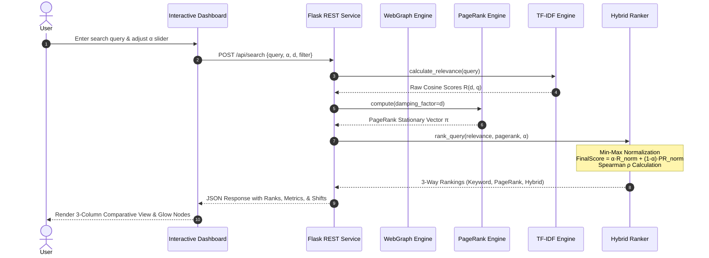

# PROJECT PROBLEM STATEMENT & SYSTEM SPECIFICATION

## Intelligent Search Ranking Using Web Graphs
### *A Miniature Search Engine Combining Graph Structure, Markov Chains, Random Walks, and Textual Relevance*

**Course:** Mathematical Foundations of Computer Science (MFCS)  
**Academic Project Document**

---

## 1. Executive Summary & Problem Overview

The rapid growth of the World Wide Web has resulted in billions of interconnected webpages. When a user submits a query, hundreds or thousands of documents may contain matching terms. Determining which documents are genuinely authoritative, relevant, and trustworthy represents one of the central challenges of information retrieval.

A naive keyword-based search engine ranks documents strictly by term frequency (TF). However, pure lexical matching is vulnerable to:
1. **Keyword Stuffing & Lexical Manipulation**: A low-quality webpage can artificially inflate its occurrence of target keywords without providing substantive or reliable information.
2. **Authoritative Conciseness**: A seminal, highly reputable reference document may use concise language and have fewer term occurrences than an exhaustive but unauthoritative blog.
3. **Absence of Topological Authority**: Keyword frequency treats documents as isolated silos, ignoring citations, endorsements, and hyperlinks from other reputable sources.

This project, **"Intelligent Search Ranking Using Web Graphs,"** designs and implements an end-to-end miniature search retrieval and ranking engine. It unifies **Linear Algebra, Graph Theory, Discrete-Time Markov Chains, and Vector Space Information Retrieval** into a hybrid ranking framework. Webpages are modeled as vertices in a directed web graph $G = (V, E)$, structural prestige is computed via the **PageRank algorithm** over the stochastic Google Matrix, and textual similarity is computed via the **TF-IDF Vector Space Model**. A candidate-level convex score fusion engine dynamically balances content relevance against structural authority, supported by a real-time interactive research dashboard.

---

## 2. Core Mathematical Objectives

1. **Directed Web Graph Construction**: Model collections of interconnected webpages as a directed graph $G = (V, E)$, formalizing link topologies through adjacency lists and adjacency matrices $\mathbf{A} \in \{0, 1\}^{N \times N}$.
2. **Topological Invariant Analysis**: Calculate in-degree (citation count), out-degree, and detect structural singularities such as dead ends (dangling nodes) and absorbing subgraphs (spider traps).
3. **Stochastic Google Matrix & Perron-Frobenius Theorem**: Formulate the row-stochastic transition matrix $\mathbf{P}$, redistribute probability mass from dangling nodes, incorporate teleportation damping $(1-d)$, and prove/verify ergodicity and convergence to the unique stationary distribution $\boldsymbol{\pi}$.
4. **Power Iteration Numerical Solver**: Implement iterative matrix-vector updates to calculate the principal eigenvector of $\mathbf{G}$ corresponding to $\lambda_1 = 1$, tracking $L_1$ residual convergence $\|\mathbf{p}^{(t+1)} - \mathbf{p}^{(t)}\|_1 < \epsilon$.
5. **Monte Carlo Random Walk Simulation**: Simulate discrete-time Markov random surfer trajectories, demonstrating the Ergodic Theorem / Strong Law of Large Numbers: empirical visit frequencies $\hat{\pi}_i(T) \to \pi_i$ as $T \to \infty$.
6. **Vector Space Model (VSM) Information Retrieval**: Build an inverted index with tokenization, stop-word elimination, sublinear term-frequency scaling, and smoothed inverse document frequency (IDF) to evaluate query-document cosine similarity.
7. **Candidate-Level Normalization & Convex Hybrid Fusion**: Implement min-max candidate normalization to place disparate dimensional scales into $[0, 1]$, computing:
   $$\text{FinalScore}(p, q) = \alpha \cdot R_{\text{norm}}(p, q) + (1 - \alpha) \cdot PR_{\text{norm}}(p)$$
8. **Quantitative Rank Correlation**: Evaluate the impact of structural authority on pure keyword ordering using Spearman's rank correlation coefficient $\rho$.
9. **Adversarial & Dynamic Graph Experiments**: Experimentally investigate the susceptibility and resilience of PageRank against Sybil link farm attacks, spider trap absorbing cycles, and variations in the damping factor $d \in [0.1, 0.99]$.
10. **Interactive Research Studio & Visualizer**: Provide an interactive web dashboard with dynamic light/dark theming, live force-directed graph physics, animated random surfer simulations, and real-time parameter tuning.

---

## 3. Mathematical Foundations

The project applies core principles from discrete mathematics, numerical linear algebra, and probability theory.

```
       [Webpage Text Corpus]                      [Directed Hyperlinks]
                 │                                          │
                 ▼                                          ▼
     ┌───────────────────────┐                  ┌───────────────────────┐
     │ Inverted Index & VSM  │                  │  Directed Graph G(V,E)│
     │  • Tokenization       │                  │  • Adjacency Matrix A │
     │  • Sublinear TF       │                  │  • In/Out Degrees     │
     │  • Smoothed IDF       │                  │  • Dangling Node Fix  │
     │  • Cosine Similarity  │                  └───────────┬───────────┘
     └───────────┬───────────┘                              │
                 │                                          ▼
                 │                              ┌───────────────────────┐
                 │                              │ Stochastic Google Mtx │
                 │                              │  • Power Iteration    │
                 │                              │  • Perron-Frobenius   │
                 │                              │  • Random Walk Surfer │
                 │                              └───────────┬───────────┘
                 │ [Relevance Score R]                      │ [PageRank Vector π]
                 └───────────────────────┬──────────────────┘
                                         ▼
                         ┌───────────────────────────────┐
                         │   Candidate Min-Max Normalizer│
                         │      R_norm  &  PR_norm       │
                         └───────────────┬───────────────┘
                                         ▼
                         ┌───────────────────────────────┐
                         │      Convex Score Fusion      │
                         │   α·R_norm + (1-α)·PR_norm    │
                         └───────────────┬───────────────┘
                                         ▼
                         ┌───────────────────────────────┐
                         │   3-Way Comparative Ranking   │
                         │    & Spearman Correlation ρ   │
                         └───────────────────────────────┘
```

### 3.1 Graph Theory & Adjacency Representations
Let $V = \{v_1, v_2, \dots, v_N\}$ be the set of $N$ webpages, and $E \subseteq V \times V$ be the set of directed edges where $(u, v) \in E$ indicates an outbound hyperlink from $u$ to $v$.
* **Adjacency Matrix** $\mathbf{A} \in \{0, 1\}^{N \times N}$:
  $$A_{ij} = \begin{cases} 1 & \text{if } (i, j) \in E \\ 0 & \text{otherwise} \end{cases}$$
* **In-Degree** (Citation Volume): $\text{deg}_{\text{in}}(i) = \sum_{j=1}^N A_{ji}$
* **Out-Degree** (Outgoing Hyperlinks): $\text{deg}_{\text{out}}(i) = \sum_{j=1}^N A_{ij} = L(i)$
* **Dangling Nodes**: Webpages with $L(i) = 0$ (no outgoing hyperlinks).

### 3.2 Stochastic Transition Matrix & Dangling Mass Redistribution
In the random-surfer model, a user navigating page $i$ follows an outgoing link uniformly at random with probability:
$$P_{ij} = \begin{cases} \frac{1}{L(i)} & \text{if } (i, j) \in E \\ 0 & \text{otherwise} \end{cases}$$
If page $i$ is a dangling node ($L(i) = 0$), row $i$ is entirely zero, violating the requirement of row-stochasticity ($\sum_j P_{ij} = 1$). To conserve probability mass, dangling rows are replaced with a uniform distribution vector $\frac{\mathbf{1}^T}{N}$:
$$\mathbf{S} = \mathbf{P} + \mathbf{a} \frac{\mathbf{1}^T}{N}$$
where $\mathbf{a} \in \{0, 1\}^N$ with $a_i = 1$ if $L(i) = 0$ and $a_i = 0$ otherwise.

### 3.3 Damping, Teleportation & The Perron-Frobenius Theorem
To resolve spider traps (absorbing cycles) and guarantee convergence, a random teleportation factor $1 - d$ (typically $d = 0.85$) is introduced:
$$\mathbf{G} = d \mathbf{S} + (1 - d) \frac{\mathbf{1}\mathbf{1}^T}{N}$$
Because $d < 1$ and $(1 - d) > 0$, the Google Matrix $\mathbf{G}$ has strictly positive entries ($G_{ij} > 0$). Consequently:
1. The Markov chain is **irreducible** (any state can be reached from any other state).
2. The Markov chain is **aperiodic** (return times have greatest common divisor 1).
3. By the **Perron-Frobenius Theorem**, $\mathbf{G}$ has a unique dominant eigenvalue $\lambda_1 = 1$, and its corresponding left eigenvector $\boldsymbol{\pi}$ is strictly positive and unique up to normalization:
   $$\boldsymbol{\pi}\mathbf{G} = \boldsymbol{\pi}, \quad \sum_{i=1}^N \pi_i = 1$$

### 3.4 Power Iteration Method
Computing $\boldsymbol{\pi}$ via explicit matrix inversion $\mathcal{O}(N^3)$ is computationally prohibitive for large graphs. The system employs **Power Iteration**:
1. Initialize $\mathbf{p}^{(0)} = \left[ \frac{1}{N}, \frac{1}{N}, \dots, \frac{1}{N} \right]$.
2. Iteratively compute:
   $$\mathbf{p}^{(t+1)} = d \left( \mathbf{p}^{(t)}\mathbf{P} + \left(\sum_{k \in \text{dangling}} p_k^{(t)}\right) \frac{\mathbf{1}^T}{N} \right) + (1 - d) \frac{\mathbf{1}^T}{N}$$
3. Terminate when the $L_1$ residual satisfies:
   $$\|\mathbf{p}^{(t+1)} - \mathbf{p}^{(t)}\|_1 = \sum_{i=1}^N |p_i^{(t+1)} - p_i^{(t)}| < \epsilon \quad (\text{e.g. } \epsilon = 10^{-8})$$

### 3.5 Monte Carlo Random Surfer & The Ergodic Theorem
To connect matrix-vector computation with empirical probability, the system simulates an explicit agent browsing the web graph:
* At step $t$, with probability $d$, the agent picks an outgoing edge $(X_t, X_{t+1})$ uniformly at random.
* With probability $1 - d$ (or if $X_t$ is a dangling node), the agent teleports to any node in $V$ chosen uniformly at random.
By the **Ergodic Theorem for Markov Chains**, the empirical visit frequency converges almost surely:
$$\lim_{T \to \infty} \hat{\pi}_i(T) = \lim_{T \to \infty} \frac{1}{T} \sum_{t=1}^T \mathbb{I}(X_t = i) = \pi_i$$

### 3.6 Vector Space Model (TF-IDF) & Cosine Similarity
Textual relevance is formalized in an inner product space $\mathbb{R}^{|V_{\text{vocab}}|}$:
* **Sublinear Term Frequency**:
  $$\text{TF}(t, d) = \begin{cases} 1 + \ln(f_{t, d}) & \text{if } f_{t, d} > 0 \\ 0 & \text{otherwise} \end{cases}$$
* **Smoothed Inverse Document Frequency**:
  $$\text{IDF}(t) = \ln\left( \frac{N + 1}{\text{df}(t) + 1} \right) + 1$$
* **Cosine Similarity**:
  $$R(d, q) = \frac{\mathbf{v}_d \cdot \mathbf{v}_q}{\|\mathbf{v}_d\|_2 \|\mathbf{v}_q\|_2} = \frac{\sum_{t \in q \cap d} w_{t, d} \cdot w_{t, q}}{\sqrt{\sum_{t \in d} w_{t, d}^2} \sqrt{\sum_{t \in q} w_{t, q}^2}}$$

### 3.7 Candidate-Level Score Normalization & Hybrid Score Fusion
Raw cosine scores $R(d, q) \in [0, 1]$ and PageRank scores $\pi_d \approx \frac{1}{N}$ occupy incompatible numerical ranges. The system executes candidate-level Min-Max normalization over the retrieved candidate set $\mathcal{D}_q$:
$$R_{\text{norm}}(d) = \frac{R(d, q) - R_{\min}}{R_{\max} - R_{\min} + \delta}, \quad PR_{\text{norm}}(d) = \frac{PR(d) - PR_{\min}}{PR_{\max} - PR_{\min} + \delta}$$
where $\delta = 10^{-12}$ prevents division by zero. If all candidate relevance scores are zero, $R_{\text{norm}}(d)$ evaluates strictly to $0.0$.

The final ranking score is formulated as the convex combination:
$$\text{FinalScore}(d, q) = \alpha \cdot R_{\text{norm}}(d) + (1 - \alpha) \cdot PR_{\text{norm}}(d), \quad \alpha \in [0, 1]$$

### 3.8 Quantitative Evaluation: Spearman's Rank Correlation
To evaluate how structural authority shifts lexical results, the engine computes **Spearman's rank correlation coefficient**:
$$\rho = 1 - \frac{6 \sum_{i=1}^k d_i^2}{k(k^2 - 1)}$$
where $d_i = \text{Rank}_{\text{method}_1}(i) - \text{Rank}_{\text{method}_2}(i)$ measures the rank displacement of document $i$.

---

## 4. Proposed System Architecture & Modules

The system is structured into five modular, decoupled software layers:

| Layer / Module | Primary Responsibilities | Theoretical Concepts |
| :--- | :--- | :--- |
| **1. Web Graph Engine** (`graph.py`) | Builds directed graphs from JSON datasets, computes adjacency matrices, maintains in/out-degree indices, detects dangling nodes, and supports dynamic graph mutations (adding/severing links, injecting synthetic subgraphs). | Graph Theory, Adjacency Matrices, In/Out-degrees. |
| **2. PageRank & Markov Engine** (`pagerank.py`, `random_walk.py`) | Constructs stochastic transition and Google matrices, executes power iteration with $L_1$ residual tracking, verifies dominant eigenvalues, runs Monte Carlo random surfer simulations, and computes Shannon entropy across damping factors. | Discrete-Time Markov Chains, Perron-Frobenius Theorem, Power Iteration, Ergodic Theorem. |
| **3. Information Retrieval Engine** (`text_engine.py`) | Tokenizes text, strips English stop words, builds inverted indices mapping terms to document postings, calculates sublinear TF-IDF vectors, and computes vector space cosine similarity. | Vector Space Model, Inverted Index, Cosine Metric, Inner Product Spaces. |
| **4. Hybrid Ranking Engine** (`ranking.py`) | Selects candidates matching query terms, performs candidate-level Min-Max score normalization, calculates convex hybrid scores, tracks rank displacement ($\Delta\text{rank}$), and evaluates Spearman rank correlation $\rho$. | Normalization, Convex Optimization, Rank Correlation Statistics. |
| **5. Experimental & Visualization Suite** (`experiments.py`, `app.py`, `main.js`) | Orchestrates adversarial link farm attacks, spider trap probability drain simulations, sensitivity sweeps, and serves a full interactive web dashboard with light/dark themes, Vis.js force graphs, and Chart.js histograms. | Adversarial Web Search, Sybil Attacks, Force-Directed Layouts, Empirical Verification. |

---

## 5. System Workflow



---

## 6. Illustrative Example

Consider a miniature web graph of 4 pages with the following hyperlinks:

| Source Page | Outgoing Links | In-Degree | Out-Degree | Topological Role |
| :--- | :--- | :---: | :---: | :--- |
| **Page A** | Page B, Page C | 1 (from C) | 2 | Topical Hub |
| **Page B** | Page C, Page D | 1 (from A) | 2 | Intermediate Router |
| **Page C** | Page A | 3 (from A, B, D) | 1 | Authoritative Authority |
| **Page D** | Page C | 1 (from B) | 1 | Citation Leaf |

### Analytical Walkthrough:
* **Structural Observation**: Page C has three incoming links, including citations from high-degree nodes A, B, and D. Consequently, power iteration assigns Page C the dominant PageRank mass.
* **Search Scenario**: Suppose a query matches Page D with high keyword frequency (e.g., keyword stuffed) but matches Page C with moderate frequency.
  * **Keyword-Only Ranking ($\alpha = 1.0$)**: Page D ranks #1, Page C ranks #2.
  * **PageRank-Only Ranking ($\alpha = 0.0$)**: Page C ranks #1, Page D ranks #4.
  * **Combined Hybrid Ranking ($\alpha = 0.50$)**: Page C is boosted to #1 because its high structural authority compensates for moderate keyword density, demoting the unauthoritative Page D.

---

## 7. Experimental Scenarios & What-If Analysis

The system includes automated experimental suites to validate theoretical edge cases:

### 7.1 Adversarial Sybil Link Farm Attack
* **Scenario**: Spammers create an artificial network of auxiliary bot pages that mutually link and funnel all outgoing hyperlinks to a target page (e.g., `page_16` - Personal Tech Blog) to artificially inflate its PageRank.
* **Observed Result**: Injecting 5 dense bot nodes funnels incoming transition probability into `page_16`, producing a dramatic PageRank gain ($> 150\%$) and elevating its position in hybrid search rankings. This demonstrates why modern search engines require adversarial TrustRank algorithms and link-farm spectral filters.

### 7.2 Spider Trap & Dangling Node Probability Drain
* **Scenario**: A closed loop of nodes links only to each other (e.g., `trap_node_1` $\leftrightarrow$ `trap_node_2`) with no outbound links to the rest of the web graph.
* **Observed Result**:
  * When $d \to 1.0$ (no teleportation), the spider trap acts as an absorbing Markov state, draining over $80\%$ of the entire graph's probability mass.
  * When standard damping $d = 0.85$ is applied, random teleportation allows the Markov surfer to escape the trap with probability $1 - d = 0.15$ per step, stabilizing the distribution across legitimate nodes.

### 7.3 Damping Factor ($d$) Sensitivity & Entropy Analysis
* Sweeping $d \in [0.10, 0.99]$ quantifies the trade-off between structural fidelity and teleportation uniformity:
  * For $d \to 0$: The Google matrix degenerates to uniform teleportation $\frac{1}{N}\mathbf{1}\mathbf{1}^T$, Shannon entropy reaches its theoretical maximum ($\log_2 N$), and rankings flatten.
  * For $d \to 1$: Structural link topology dominates, but numerical convergence slows significantly, requiring more power iterations. Optimal stability is achieved at $d \approx 0.85$.

---

## 8. Scope, Limitations & Future Extensions

### Scope of Implementation
* **Corpus**: Operates on a controlled, academic dataset of 18 rich computer science documents with diverse graph structures (hubs, authorities, dangling leaves, cross-domain links).
* **Engines**: Built from first principles in Python (using NumPy for vectorized matrix operations) to ensure transparency for academic inspection.
* **Frontend**: Interactive web visualizer supporting real-time graph exploration, dynamic edge editing, Markov surfer animation, dual light/dark themes, and an uncluttered Search Studio with a Focused result stream, side-by-side comparative mode, and real-time score decomposition inspector.

### Challenges & Limitations
1. **Corpus Scale**: Demonstrations operate on manageable local graphs ($N \approx 20 - 50$ nodes). Real-world web engines operate on sparse graphs of $N > 10^{10}$ nodes requiring distributed MapReduce or Pregel architectures.
2. **Semantic Gap**: The Vector Space Model relies on lexical token matching. It does not capture latent semantic embeddings, deep neural contextual queries (e.g., BERT/Transformers), or polysemy.
3. **Link Spam Vulnerability**: Basic PageRank is vulnerable to coordinated Sybil attacks unless augmented with seed-based TrustRank or spectral sparsification.

### Suggested Future Extensions
* **Personalized / Topic-Sensitive PageRank**: Replace the uniform teleportation vector $\frac{\mathbf{1}^T}{N}$ with a non-uniform topic preference distribution $\mathbf{v}_{\text{topic}}$ biased towards specific categories.
* **Okapi BM25 Ranking Function**: Upgrade the term frequency component to BM25 to incorporate document length saturation parameters ($k_1, b$).
* **HITS Algorithm Comparison**: Implement Kleinberg's Hyperlink-Induced Topic Search to compare mutual Hubs and Authorities against PageRank's single stationary distribution.

---

## 9. Academic Significance

This project demonstrates the direct application of fundamental mathematical concepts to modern information retrieval:
* **Graph Theory** models hyperlink connectivity and topology.
* **Linear Algebra** powers transition probability matrices, dominant eigenvector extraction, and vector space similarity.
* **Probability Theory & Markov Chains** model user navigation, stationary distributions, and ergodic convergence.
* **Statistics** provides quantitative ranking evaluation via Spearman's rank correlation.

By integrating these four mathematical pillars into a single interactive studio, the project provides an intuitive, hands-on platform for analyzing the mechanics that transformed web search from simple keyword matching into a rigorous mathematical science.

